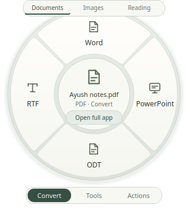

# Filewink

Small file actions, with a full editor when you need it.

Convert photos, edit PDF pages, trim and join videos, and read text from images.
File processing stays on your computer. No account, uploads or ads.

**[Download the Ubuntu beta](https://github.com/ayushxaw/filewink-downloads/releases/download/v0.5.4-beta.1/filewink-0.5.4-beta1-ubuntu-amd64.deb)** · [Release notes and checksums](https://github.com/ayushxaw/filewink-downloads/releases/tag/v0.5.4-beta.1)

For **Ubuntu 24.04 or 26.04 on 64-bit Intel/AMD computers**. This is an early
beta. Other distributions, older Ubuntu releases and ARM are not supported yet.



## Install

Download the `.deb`, open a terminal in its folder, and run:

```bash
sudo apt install ./filewink-0.5.4-beta1-ubuntu-amd64.deb
```

Apt installs the required Ubuntu libraries and conversion tools. LibreOffice
components install with normal apt recommendations. Internet is needed for
missing packages. You do not need to install Python packages or clone a repo.

Open Filewink from Applications, or choose **Open With → Filewink** on a file.
The small wheel opens quick actions; **Open full app** opens the larger editors.

For **Shift+hold** and **Shift+Space** in GNOME Files, choose **Enable Files
gestures** in Filewink settings, then close and reopen Files. The right-click
provider also loads when Files restarts. Desktop icons and other file managers
can use Open With; the hold gesture is specific to GNOME Files.

## Everyday tools

- Photos: JPEG, PNG, WebP, AVIF and more; crop, resize, rotate and annotate.
- PDFs: merge, split, reorder, remove and rotate pages; compress, password
  protect, extract pictures, and export text, documents or page images.
- Videos: trim the beginning, end or middle; join kept clips; compress and export.
- Text: offline OCR with a review step before copying or saving the result.

PDF-to-document conversion can change layout. PDF-to-PowerPoint creates image
slides. OCR can make mistakes. Keep your original signed PDFs. HEIC, PDF text
editing and a multitrack video timeline are not included.


## Remove

If you enabled user gestures, remove them before removing the app:

```bash
filewink-integrate --uninstall
sudo apt remove filewink
```

Quit Filewink first. Your originals, generated files and settings are kept.

## Windows

Windows is in development. The native build, installer and Explorer gestures
are being tested; there is no finished Windows download in this release.

## About this repository

This is the public download and issue tracker. The Filewink application
repository stays private. The releases contain the app installer, checksums,
installation notes, and matching third-party dependency sources. Those sources
are for Qt/PySide/FFmpeg and do not contain Filewink's private application source.
The application and dependencies retain their individual licences, included in
the installed app under **About → Third-party licences**.

Found a bug? [Open an issue](https://github.com/ayushxaw/filewink-downloads/issues)
with your Ubuntu version, what you tried and what happened. Leave private files
and passwords out of public reports.

Made by Ayush Awasthi. Filewink is free to use. A voluntary support link will be
added when it is ready.
